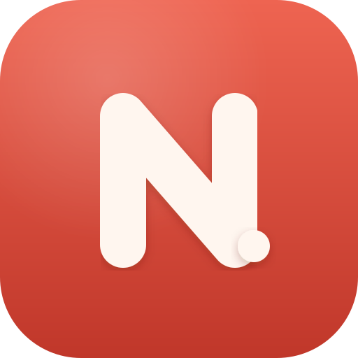

# Notewell

<p align="center">
  
  <br />
  <strong>A local-first Markdown notes app crafted for macOS.</strong>
  <br />
  <a href="https://notewell-1mi.pages.dev">🌐 <strong>Website & Live Demo</strong></a> ·
  <a href="https://github.com/baskaranz/notewell/releases/tag/v1.0.0">⬇️ <strong>Download v1.0.0 (macOS)</strong></a>
</p>

<p align="center">
  <a href="https://notewell-1mi.pages.dev"></a>
  <a href="https://github.com/baskaranz/notewell/releases/tag/v1.0.0"></a>
  
  
</p>

---

> Visit the official product site at **[https://notewell-1mi.pages.dev](https://notewell-1mi.pages.dev)** to try the interactive live editor and theme preview.

Notewell is an original, local-first Markdown notes app for the desktop (Electron). The architecture is informed by a clean-room study of mature note apps — a single Markdown source of truth, with tags, todos, and backlinks *derived* directly from your text. Zero cloud accounts. Zero surveillance.

## Features

- **Live editor** — Markdown styles inline as you type (headings, bold/italic, code,
  quotes); formatting marks hide on lines you're not editing. `#tags` and `[[wikilinks]]`
  are highlighted.
- **Markdown mode** — raw source on the left, rendered preview on the right (`⌘\` to toggle).
- **Search** — full-text search across titles and bodies.
- **Organize** — nested `#tags`, backlinks, pin, rename (double-click a title), and a Trash
  with restore / delete-forever.
- **9 themes** — Default Dark/Light, Solarized Dark/Light, Dracula, Nord, Gotham, Charcoal,
  Sepia (🎨 button). Remembered across launches.
- **Encryption** — lock any note with a passphrase (PBKDF2-HMAC-SHA256 → AES-256-GCM, all local; the key never leaves the renderer). Unlock to read, remove encryption to store plaintext again.
- **Native menu bar** with real shortcuts, window-state persistence, and an About panel.
- **Export** any note as a `.md` file; **Empty Trash** with confirmation.
- **Three-pane layout** — navigator (All Notes / Trash / Tags) · note list with previews · editor.

## Run from source

```bash
npm install     # installs deps; downloads Electron
npm start       # bundles the renderer, then launches
npm run dev     # same, with devtools
```

## Build a distributable

```bash
npm run pack    # unpacked dist/mac-arm64/Notewell.app
npm run dist    # dist/Notewell-<version>-arm64.dmg  (+ .zip)
```

The build is **unsigned** (`mac.identity: null`). To ship it, set up an Apple Developer
ID and notarization in the `build` block of `package.json`.

## Shortcuts

| Action | Key |
|--------|-----|
| New note | `⌘N` |
| Export as Markdown | `⌘⇧E` |
| Move to Trash | `⌘⌫` |
| Lock / Unlock note | `⌘L` |
| Live / Markdown mode | `⌘1` / `⌘2` / `⌘\` |
| Find in notes | `⌘F` |
| Preferences (themes) | `⌘,` |

## Architecture

| Layer | Choice |
|-------|--------|
| Shell | Electron (main + sandboxed renderer, context isolation, single-instance) |
| Storage | SQLite via `sql.js` (WASM); persisted to `userData/notewell.sqlite` |
| Editor | CodeMirror 6 (custom live-Markdown extensions) |
| Preview | `marked` |
| Bundling | esbuild (renderer); electron-builder (packaging) |

```
src/main/main.js     Electron main: window, menu, window-state, IPC, export
src/main/db.js       SQLite schema, derivation (tags/todos/links), queries
src/preload/         contextBridge API — the only renderer↔main surface
src/renderer/        index.html, renderer.js, markdown-live.js, themes.js, styles.css
assets/logo.svg      source logo;  build/icon.icns + icon.png generated from it
build/esbuild.mjs    renderer bundler
```

## Roadmap

1. **Import** — TextBundle / zip note bundles.
2. **Sync** — pluggable backend (local-first; a server/CRDT layer later).
3. **Attachments** — images/files with list thumbnails.
